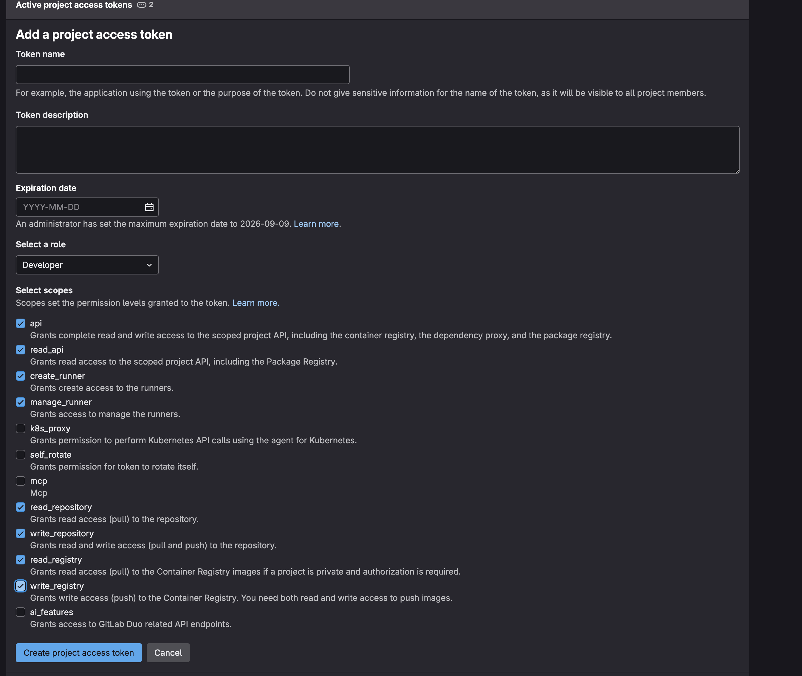
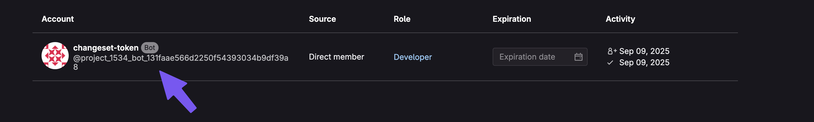

# Access Token für Changesets konfigurieren

Damit changesets im Projekt funktioniert müssen zwei CI/CD Variablen befüllt werden.

- GITLAB_TOKEN
- GITLAB_CI_USER_NAME

## Schritt 1: Gitlab Token erstellen

Erstelle einen neuen Accesstoken im Projekt. Dieser wird dann in den [CI/CD Variablen](https://git.congstar.net/congo-web/design-system/fair/-/settings/ci_cd#js-cicd-variables-settings) unter GITLAB_TOKEN eingetragen.

## Schritt 2: Gitlab User Name herausfinden

Um den GITLAB_CI_USER_NAME zu befüllen müssen wir den Usernamen des AccessTokens herausfinden.

Nachdem der Accesstoken erstellt wurde, filtere die User des [fair Projekts](https://git.congstar.net/congo-web/design-system/fair/-/project_members) nach „User Created“. Der Username hat immer die projekt id mit im Namen, bei fair also project_1534. Suche nach dem zuletzt erstellten User mit diesem Namen. Der Name des Users ist der Name des AccessTokens. Wir brauchen allerdings die genaue Bezeichnung.

