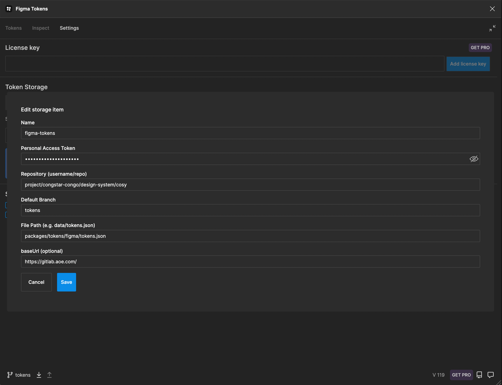
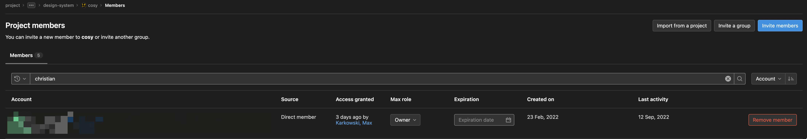

# @fair/tokens - Congstar Design Tokens

In der Datei `figma/tokens.json` befinden sich alle Design Tokens, die zwischen Entwickler:innen und Designer:innen
synchronisiert werden.
Erreicht wird dies durch das Figma
Plugin [Figma Tokens](https://www.figma.com/community/plugin/843461159747178978/Figma-Tokens)

[[_TOC_]]

## Installation

```shell
# mit pnpm
pnpm add @fair/tokens

# mit yarn
yarn add @fair/tokens

# mit npm
npm install @fair/tokens
```

Um die @fair Packages installieren zu können, muss die private npm Registry konfiguriert sein (`.npmrc`).

```shell
@congstar:registry=https://git.congstar.net/api/v4/projects/909/packages/npm/
@fair:registry=https://git.congstar.net/api/v4/projects/1047/packages/npm/
//git.congstar.net/api/v4/projects/909/packages/npm/:_authToken="${NPM_TOKEN}"
//git.congstar.net/api/v4/projects/1047/packages/npm/:_authToken="${CONGSTAR_GITLAB_FAIR_NPM_TOKEN}"
```

## Bearbeiten eines Tokens

> :exclamation: **Achtung** :exclamation:
>
> Tokens nur in Absprache mit Designer:innen/Entwickler:innen ändern! Die Designer:innen und Entwickler:innen müssen
> darauf achten das Ihre Änderungen gleichzeitig released werden.

> :exclamation: **Achtung** :exclamation:
>
> Für Änderungen an den Tokens bitte **immer** im `tokens` Branch des Repository arbeiten. Nur dieser Branch wird mit
> Figma synchronisiert!

Sobald ein push im `tokens` Branch stattfindet (über das Figma Token Plugin oder direkt im Code) und die Pipeline
durchgelaufen ist, wird automatisch ein Merge Request geöffnet, falls noch nicht vorhanden.

Bevor dieses Merge Request gemergt wird, sollte noch ein [changeset](../../docs/release.md) angelegt werden, das die
Änderungen in diesem MR beschreibt.
Anschließend wird der gleiche Prozess durchlaufen wie in der [Release-Dokumentation](../../docs/release.md) beschrieben.

## Wie werden die Tokens transformiert?

Die Tokens werden mit [style-dictionary](https://github.com/amzn/style-dictionary) und dem Transformer von tokens-studio [sd-transforms](https://github.com/tokens-studio/sd-transforms) in die Zielplatformen (
js, css,scc) transformiert.

Es wurden spezielle filter, formatter, mapper, matcher und transformer für unseren Einsatzzweck entwickelt. Diese sind
unter `src` zu finden.

Wie, was und wohin die Tokens transformiert werden wird in der `config.ts` definiert.

## Eine weitere Platform hinzufügen

Aktuell steht ein Package mit Tokens für JavaScript/TypeScript zur Verfügung. Wenn weitere Platformen, wie z.B. iOS
unterstützt werden sollen, muss dies mithilfe von [style-dictionary](https://github.com/amzn/style-dictionary)
implementiert werden. Auch muss die Pipeline und der Releaseprozess für diese Platformen angepasst bzw. erweitert
werden.

In der `config.ts` Datei werden die Ausgabeformate und die Transformationen definiert. Es werden von style-dictionary
schon viele Transformationen angeboten. Individuelle Anpassungen finden in dem `src` Ordner statt.

## Dokumentation der Token

Die Token werden ausschließlich im [Design System Portal](https://marke.congstar.net/1df10c0d0/p/21376a-entwickler) dokumentiert.

## Einstellung Figma Tokens & Gitlab



Doku für Gitlab: https://docs.figmatokens.com/sync/gitlab

## Nutzung der Tokens in neuem Figma File

Wenn man in dem Figma Plugin die Gitlab Einstellungen vorgenommen hat, kann man die Tokens für jede neue Datei über Gitlab holen.


### Troubleshoot

Solltest du die Tokens nicht editieren können, fehlt dir der direkte Zugang zu dem fair Repository. Auch wenn man in der Gitlab Gruppe schon hinzugefügt ist, funktioniert das Editieren im Plugin nicht.
Um das zu fixen, muss man den besagten Nutzer direkt für das Repo einladen.


Dies ist noch ein Bug im Plugin, siehe https://github.com/six7/figma-tokens/issues/479#issuecomment-1209714839
Dies ist ein Bug im Plugin, siehe https://github.com/six7/figma-tokens/issues/479#issuecomment-1209714839
-->
